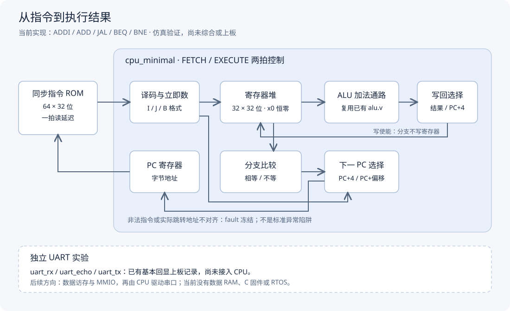

# riscv-soc-cyclone4-uart

在小梅哥 AC101-EDA（Cyclone IV EP4CE6E22C8）上构建精简 RISC-V 小计算机，逐步连接 UART 交互与小型内核。

当前已有能执行程序的 CPU 雏形，支持 ADDI、ADD、JAL、BEQ、BNE。CPU 目前只经过 Icarus Verilog 仿真，尚未综合或上板，不是完整 RV32I。UART 收发回显是独立实验，尚未与 CPU 相连。

## 当前架构



图中的执行通路是当前实现，底部 UART 是独立实验，不代表已完成 SoC 集成。[SVG 图源](main/docs/architecture.svg) 可直接编辑；[架构说明](main/docs/architecture.md) 提供模块边界、状态转换与后续方向。

## 已实现与验证范围

| 部分 | 当前能力 | 验证状态 |
|---|---|---|
| 32 位 ALU | 加法、减法、按位与、zero 标志 | 九组独立仿真检查通过 |
| 最小 CPU | 两拍取指执行、寄存器堆、同步指令 ROM、五类指令 | 九组 CPU 场景通过 |
| 条件分支 | BEQ / BNE、正反向偏移、计数循环 | 跳转与不跳转、写回抑制和对齐边界检查通过 |
| UART | 字节发送、接收、基本回显 | 已有基本上板演示记录，非压力测试 |
| CPU 驱动 UART | 尚未实现 | 尚无验证 |
| C 固件、机器态陷阱、计时器与 FreeRTOS | 后续目标 | 尚未实现 |


## 目录结构

```text
riscv-soc-cyclone4-uart/
├── README.md
├── LICENSE
└── main/
    ├── cpu_minimal/
    │   ├── cpu_minimal.v       # 取指、译码、执行与 PC 控制
    │   ├── regfile.v           # 两读一写的通用寄存器堆
    │   ├── instruction_rom.v   # 同步指令 ROM 与默认程序
    │   └── cpu_minimal_tb.v    # 自动检查与测试程序
    ├── uart_tx_demo/
    │   ├── alu.v              # CPU 复用的 32 位 ALU
    │   ├── alu_tb.v           # ALU 独立测试
    │   ├── uart_tx.v          # 可请求的字节发送器
    │   ├── uart_rx.v          # 字节接收器
    │   ├── uart_echo.v        # 回显连接模块
    │   └── ...                # 固定字符实验与 Quartus 工程文件
    └── docs/
        ├── architecture.md
        └── architecture.svg
```


## 运行 CPU 仿真

需要 Icarus Verilog，命令行可访问 `iverilog` 与 `vvp`。以下命令在仓库根目录的 PowerShell 中运行，产物写入系统临时目录，不覆盖仓库内已有仿真产物：

```powershell
$sim = Join-Path ([IO.Path]::GetTempPath()) ('riscv-cpu-' + [guid]::NewGuid().ToString('N') + '.vvp')
iverilog -g2012 -Wall -s cpu_minimal_tb -o $sim main/uart_tx_demo/alu.v main/cpu_minimal/regfile.v main/cpu_minimal/instruction_rom.v main/cpu_minimal/cpu_minimal.v main/cpu_minimal/cpu_minimal_tb.v
if ($LASTEXITCODE -eq 0) { vvp $sim }
```

通过时末尾输出：

```text
PASS: all CPU scenarios passed
```

若找不到命令，请将已安装 Icarus Verilog 的 bin 目录加入当前终端 PATH，或使用可执行文件的完整路径。当前 `-Wall` 会报告设计模块未声明时间单位；测试台已声明 `1ns/1ps`，设计模块没有延时表达式。测试遇到不符预期的结果会通过 `$fatal` 退出，不能只依据编译成功判断测试通过。

## 程序示例

默认 ROM 保留四条启动指令：

```asm
addi x1, x0, 5
addi x2, x0, 3
add  x3, x1, x2
jal  x0, 0
```

CPU 将 8 写入 x3，随后反复执行最后一条跳转，不是硬件停钟。测试台还会在复位期间装入其他程序，检查计数到 3 后退出的条件循环、寄存器依赖、x0、符号扩展、回绕及故障边界；计数循环不是默认 ROM 的启动程序。

## 后续方向

先补数据访存接口及必要指令，建立 CPU 经 MMIO 驱动 UART 的闭环，再扩展裸机串口命令行。机器态陷阱、计时器、上下文切换和精简 FreeRTOS 留在后续阶段

## 许可

使用与分发条件见 [LICENSE](LICENSE)。
