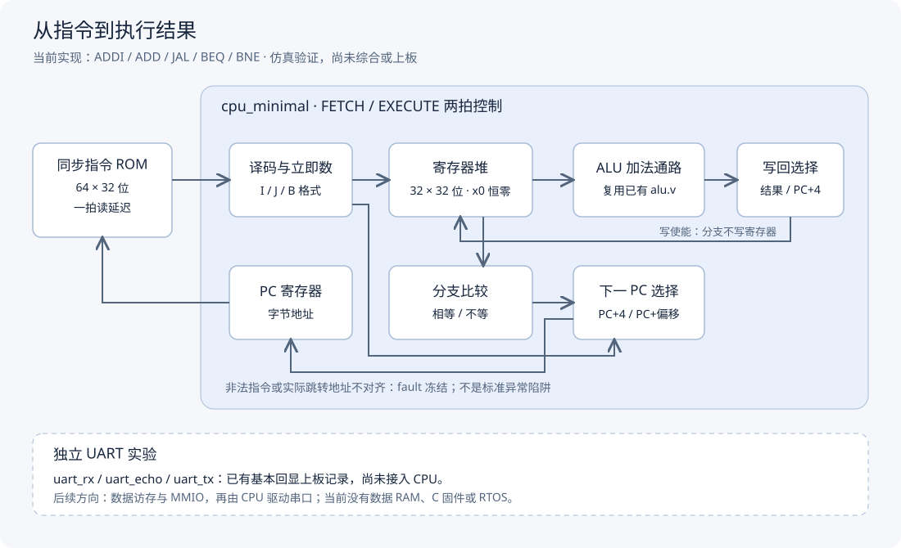
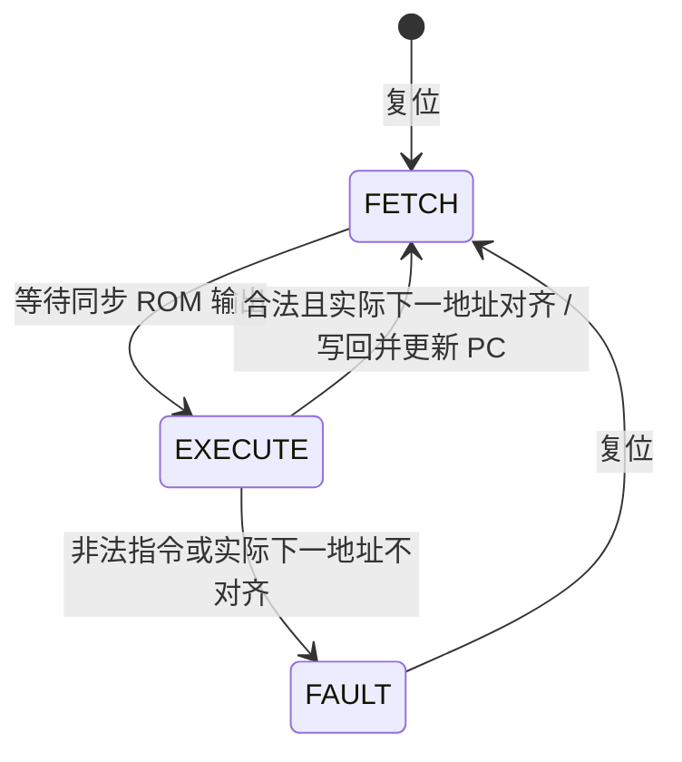

# 当前 CPU 架构

本页描述已实现的指令子集 CPU，不是完整 RISC-V SoC。UART 是独立实验，当前不存在 CPU 到 UART 的总线连接。

## 模块关系

| 模块 | 输入与输出 | 约束 |
|---|---|---|
| instruction_rom | 字节地址输入，32 位指令输出 | 同步读、一拍延迟；64 个字，越界或不对齐返回零指令 |
| cpu_minimal | 时钟、低有效复位、指令输入；PC、指令地址、fault、退休轨迹输出 | 固定两拍，无可变延迟总线握手 |
| regfile | 两组读地址，一组写地址与数据 | 两个组合读端口、上升沿写入，x0 恒零，异步复位清零 |
| alu | 两个操作数、运算选择；结果与 zero | CPU 只用加法路径；独立 ALU 还支持减法和按位与 |

## 两拍执行

执行沿读取旧 PC 对应的指令并更新 PC；随后 FETCH 沿让同步 ROM 获取新 PC 的指令；下一 EXECUTE 沿使用它。不能将指令接口直接替换为需要额外等待的存储器而不修改控制。

## 运算与 PC 选择

- ADDI：寄存器加符号扩展后的十二位立即数，结果写入 rd。
- ADD：两个寄存器相加，结果写入 rd。
- JAL：目标为当前 PC 加有符号偏移，旧 PC+4 写入 rd。
- BEQ / BNE：比较两个寄存器，条件成立时目标为当前 PC 加 B 型有符号偏移，否则执行 PC+4；不写任何通用寄存器。

B 型偏移最低位固定为零；本实现无压缩指令，实际采用的下一地址仍必须四字节对齐。条件未成立时不会因为未采用目标不对齐而报错。

## 写回与调试

写回要求正在 EXECUTE、未 fault、指令合法、允许寄存器写入及实际下一地址对齐。寄存器堆还拒绝写 x0。分支指令没有 rd，必须禁止写回，不能把立即数字段当目的寄存器。

正常完成指令后 retired 有效一拍，附带执行前 PC、指令和写回信息。分支的 retired_rd/data 为零；写 x0 的退休数据也为零，表达没有实际通用寄存器写入。fault 后冻结 PC 并停止退休，直到复位；这不是标准 RISC-V trap/CSR 机制。

## 证据与边界

依据源码：

- [CPU 控制与数据选择](../cpu_minimal/cpu_minimal.v)
- [寄存器堆](../cpu_minimal/regfile.v)
- [同步 ROM](../cpu_minimal/instruction_rom.v)
- [自动检查与测试程序](../cpu_minimal/cpu_minimal_tb.v)
- [复用 ALU](../uart_tx_demo/alu.v)

已有九组 CPU 仿真场景通过的记录，具体复现见 [README](../../README.md#运行-cpu-仿真)。没有数据 RAM、MMIO、C 运行环境、标准异常、中断或 RTOS，也没有本 CPU 的 Quartus 资源及时序证据。图和文档不是新增硬件能力的证明。

后续首先围绕 CPU 访问 UART 设计数据访存接口及指令，已验证的独立串口模块可复用，但不能未经集成就视为 CPU 已输出字符。
